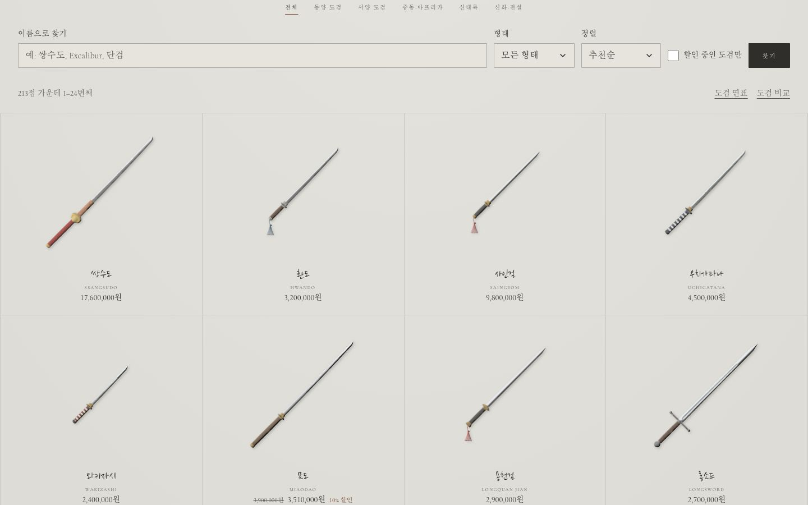
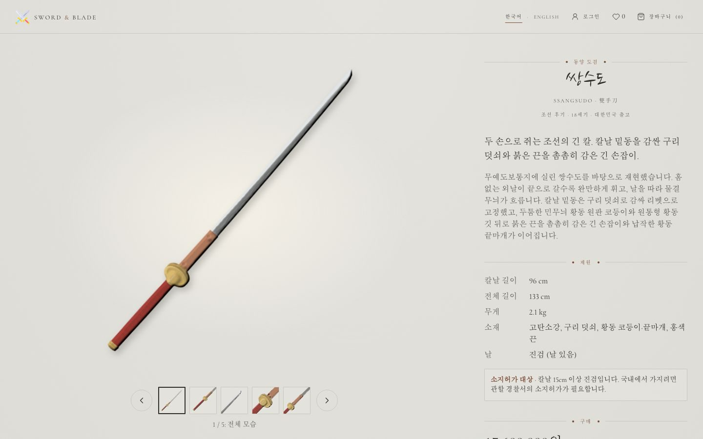
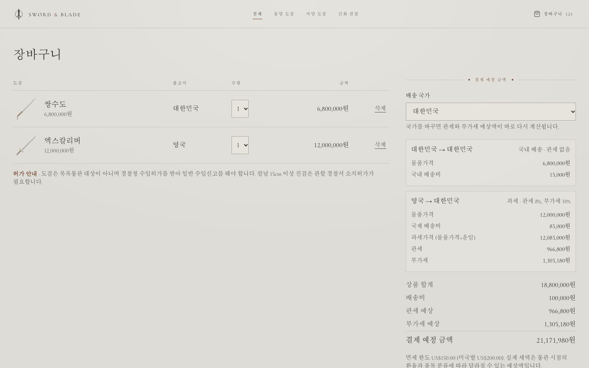
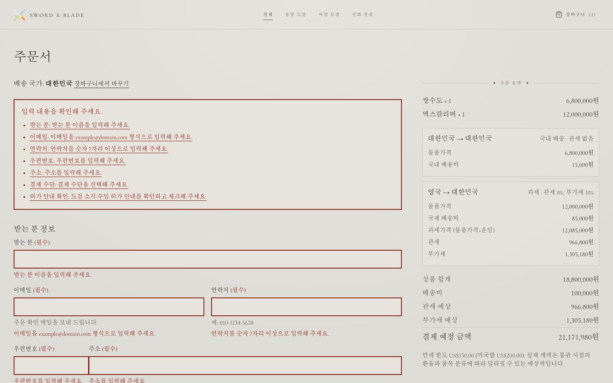
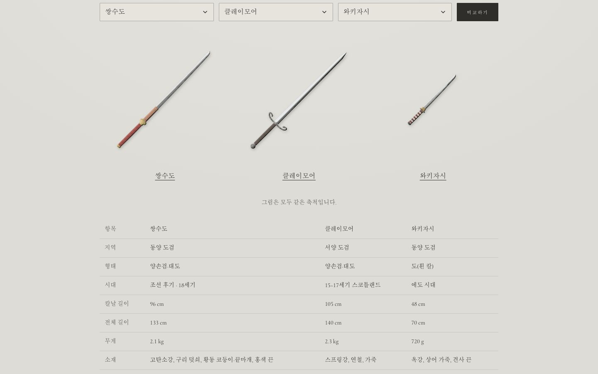
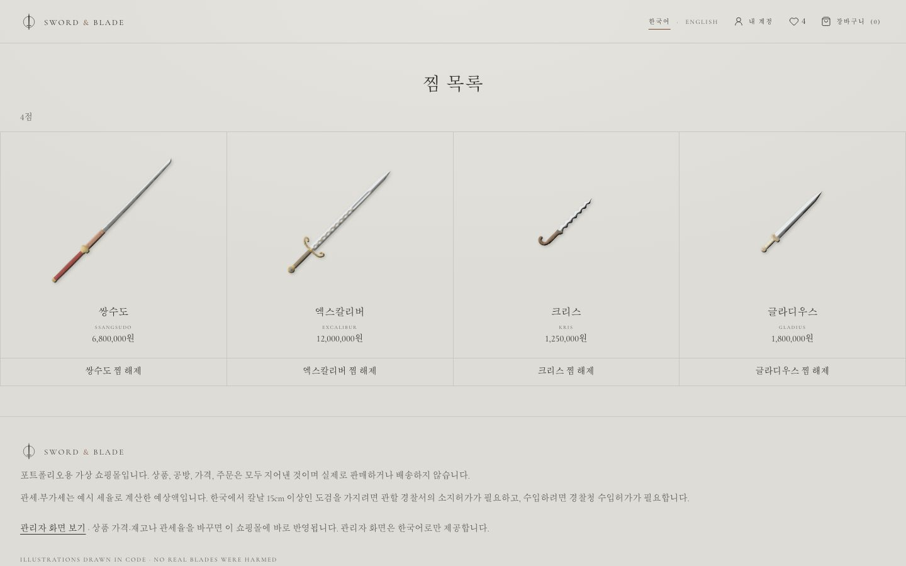
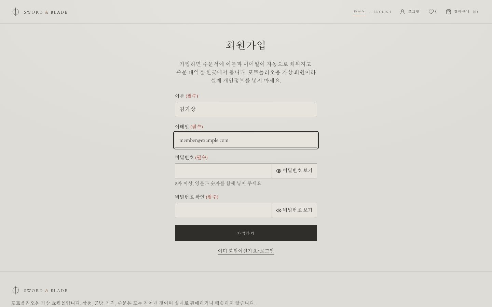
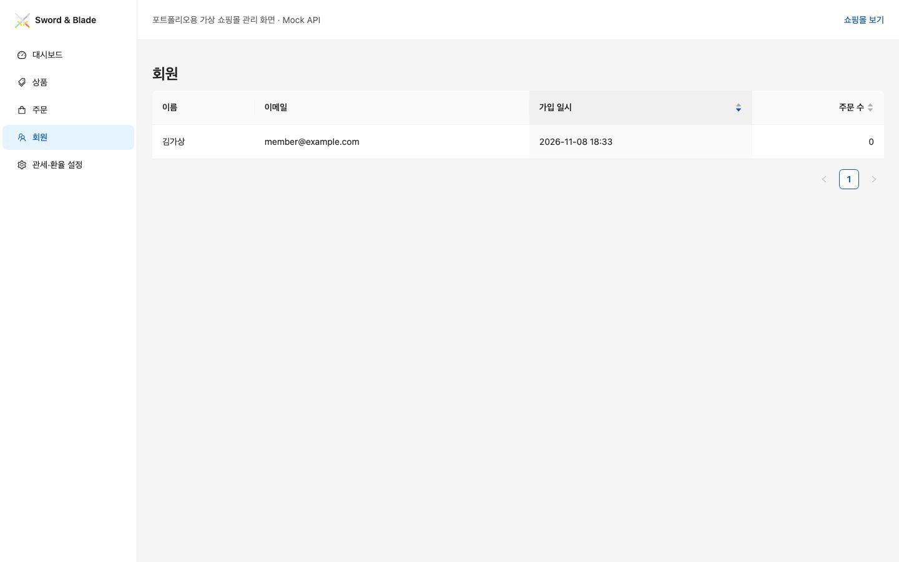
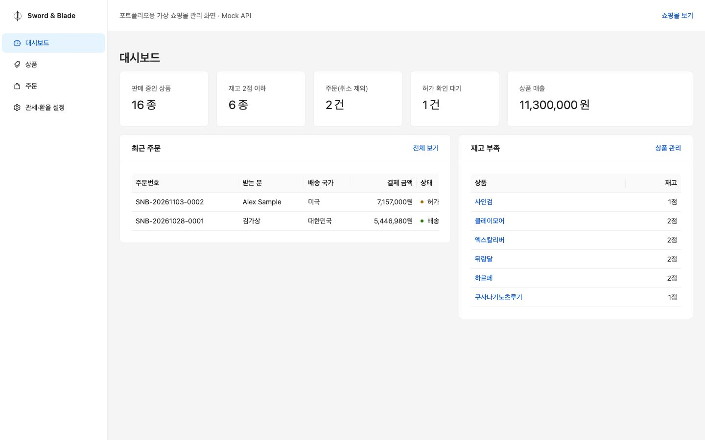
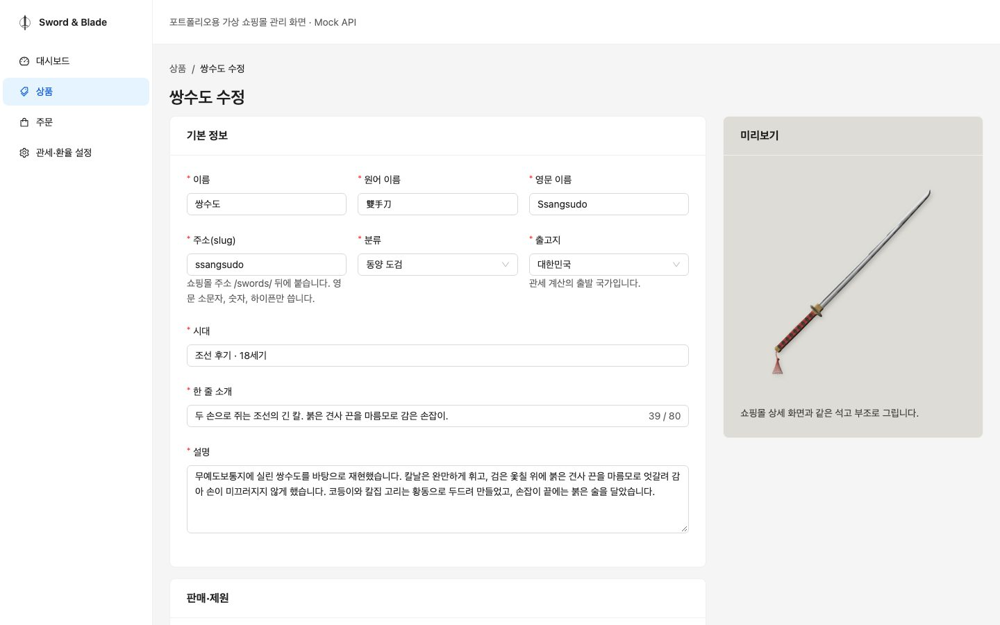

# Sword & Blade - 도검의 벽

[](https://github.com/ryushin01/swordnblade/actions/workflows/ci.yml)


동양 도검부터 신화 속 검까지, 석고 벽에 새긴 부조처럼 진열한 도검 쇼핑몰과 관리자 화면입니다. 배송 국가에 따라 관세·부가세를 미리 계산합니다.

**[쇼핑몰 보기](https://swordnblade-ryushin01.vercel.app/)** · **[English](https://swordnblade-ryushin01.vercel.app/en)** · **[어드민 보기](https://swordnblade-ryushin01.vercel.app/admin)** · **[Storybook](https://swordnblade-ryushin01.vercel.app/storybook)** · 로그인 없이 바로 쓸 수 있습니다. 어드민에서 바꾼 가격·재고·관세율은 같은 브라우저의 쇼핑몰에 바로 반영됩니다.

> **프로젝트 상태:** 실제로 판매하지 않는 **포트폴리오 프로젝트**입니다. 백엔드 없이 Mock API(MSW)로 동작하며, 상품·공방·가격·주문은 모두 가상 데이터입니다. 세율과 환율은 예시 값입니다.

## 화면

모든 도검 일러스트는 이미지 파일 없이 코드(SVG)로 그렸습니다.

| 도검의 벽 | 쌍수도 상세 |
|---|---|
|  |  |

| 장바구니 관세 계산 | 주문서 오류 안내 |
|---|---|
|  |  |

| 도검 비교 | 찜 목록 |
|---|---|
|  |  |

| 회원가입 | 어드민 회원 목록 |
|---|---|
|  |  |

| 어드민 대시보드 | 어드민 상품 수정 |
|---|---|
|  |  |

언어·모바일 화면은 [디자인 문서](docs/design.md#화면)에 있습니다.

## 주요 기능

**쇼핑몰** (`apps/shop`)

| 기능 | 내용 |
|---|---|
| 도검의 벽 | 동양·서양·중동·아프리카·신대륙의 역사 도검 101점과 신화·전설의 검 112점, 모두 213점. 같은 축척으로 그려 길이 차이가 보입니다. 지역과 형태로 거르고, 이름(한글·원어·영문)으로 찾고, 가격·길이로 정렬하며 24점씩 나눠 봅니다. |
| 석고 부조 일러스트 | 칼날·코등이·손잡이 감기·끝장식·술을 매개변수로 그리고 SVG 조명 필터로 부조처럼 보이게 합니다. |
| 상세 갤러리 | 부조 그림 다섯 시점(전체·손잡이·칼끝·코등이·칼날 중간 또는 덧쇠)과 어드민에서 올린 사진을 썸네일과 이전·다음 버튼으로 넘겨 봅니다. 넓은 화면에서는 설명을 스크롤하는 동안 부조가 천천히 돌며 다가오고 빛이 부조를 훑습니다(CSS 스크롤 타임라인). |
| 할인 | 상품마다 할인율과 기간(한국 시간 날짜)을 정합니다. 정가에 줄을 긋고 할인가·할인율을 함께 보여 주고, 할인 중인 도검만 거를 수 있습니다. 가격 정렬·장바구니·관세도 할인가로 계산합니다. |
| 관세 계산 | 출고지별로 묶어 계산합니다. 해외 → 한국(면세 150달러, 미국발 200달러, 관세 8%, 부가세 10%)과 한국 → 해외(국가별 CIF·FOB, 부가세)를 모두 지원합니다. |
| 한국어·영어 | 한국어는 `/`, 영어는 `/en`. 화면 글, 도검 213점의 설명과 이야기, 국가별 허가 안내를 영어로 옮겼고, 머리글에서 언어를 바꿉니다. 어드민은 한국어만 제공합니다. |
| 허가 안내 | 칼날 15cm 이상 진검은 소지허가 대상으로 표시하고, 주문할 때 허가 안내를 확인받습니다. |
| 주문 | 오류 요약과 칸별 안내, 중복 제출 방지. 금액은 Mock 서버가 다시 계산합니다. |
| 회원 | 회원가입·로그인, 내 계정(회원 정보·내 주문, 출고 전 주문 취소). 로그인하면 주문서에 이름과 이메일이 채워집니다. |
| 후기 | 구매한 회원만 별점과 글을 남기고, 프로필 사진이 원형으로 보입니다. |
| 도검 연표 | 역사 도검을 시대와 지역 표로 펼쳐 봅니다. |
| 찜·비교 | 도검을 찜해 모아 보고(로그인하면 계정에 저장), 최대 3점을 같은 축척과 제원 표로 비교합니다. 상세 아래에 같은 지역의 도검을 추천합니다. |

**어드민** (`apps/admin`, Ant Design, 쇼핑몰 주소의 `/admin`)

어드민은 쇼핑몰과 같은 주소에서 열려(Next.js multi-zones) Mock 데이터를 함께 씁니다. 로그인 화면에 공개한 데모 계정으로 들어갑니다. 어드민에서 바꾼 내용이 쇼핑몰에, 쇼핑몰 주문이 어드민에 보입니다.

| 메뉴 | 내용 |
|---|---|
| 대시보드 | 상품·재고 부족·주문·허가 확인 대기·매출 통계 |
| 상품 | 목록(이름 찾기·정렬·필터), 등록·수정·삭제, 할인율·기간 정하기(판매가 미리보기), 사진 여러 장 올리기(대체 텍스트 필수). 칼끝·홈·하몬·상감·손잡이 감기·술 색, 전해지는 이야기, 영어 글까지 고치고 일러스트를 바로 미리 봄 |
| 주문 | 주문 상세 펼치기, 상태 변경(취소하면 재고 복구) |
| 회원 | 쇼핑몰에서 가입한 회원과 회원별 주문 수 |
| 관세·환율 설정 | 환율, 배송비, 국가별 관세율·부가세율·면세 한도 |

## 기술 스택


| 구분 | 사용 기술 |
|---|---|
| 구성 | pnpm 워크스페이스, Turborepo, Feature-Sliced Design v2.1 (Steiger로 검사) |
| 프레임워크 | Next.js 16 (App Router, multi-zones), React 19, TypeScript 6 |
| 쇼핑몰 UI | Tailwind CSS 4, shadcn/ui(Button, Sonner), lucide-react, Cormorant Garamond(영문), 운영체제 명조체(한글), 나눔손글씨 붓(칼 이름에 쓰인 247자만) |
| 어드민 UI | Ant Design 6, @ant-design/icons |
| 상태·데이터 | TanStack Query 5, Zustand 5, MSW 3 (Mock API), next-intl 4 (한국어·영어) |
| 품질 | ESLint(Next.js 규칙, import 정렬), Prettier, husky + lint-staged, Vitest 5 + Testing Library, Storybook 10 스토리 테스트(실제 브라우저 + axe), Playwright + axe(프로덕션 빌드·배포 사이트 E2E), eslint-plugin-jsx-a11y, size-limit, Lighthouse CI |
| 모니터링 | Sentry(DSN이 있을 때만), web-vitals |
| 배포 | Vercel(앱별 프로젝트, Git 연동), GitHub Actions, Dependabot |

## 시작하기

Node.js 22 이상(`.nvmrc`)과 pnpm 12가 필요합니다.

```bash
corepack enable pnpm
pnpm install
pnpm dev    # 쇼핑몰 http://localhost:3000 · 어드민 http://localhost:3000/admin
```

| 명령 | 설명 |
|---|---|
| `pnpm build` | 두 앱 프로덕션 빌드 |
| `pnpm test` | 단위·컴포넌트 테스트 (도메인, Mock API, 일러스트, 두 앱) |
| `pnpm test:storybook` | 모든 스토리를 실제 브라우저에서 렌더링하고 접근성 검사 |
| `pnpm typecheck` / `pnpm lint` | 타입 검사 / ESLint와 FSD 규칙 검사(Steiger) |
| `pnpm format` | Prettier로 서식 정리 (커밋할 때 바뀐 파일은 자동 정리) |
| `pnpm --filter @snb/shop size` / `lhci` | 쇼핑몰 번들 크기 / Lighthouse 기준 검사 (먼저 `build` 필요) |
| `pnpm --filter @snb/shop e2e` | 쇼핑몰 프로덕션 빌드 E2E (먼저 `build` 필요, `E2E_BASE_URL`을 주면 배포된 사이트 검사) |
| `pnpm --filter @snb/shop storybook` | 쇼핑몰 Storybook (`http://localhost:6006`) |

## 프로젝트 구조

```
apps/
├─ shop/       쇼핑몰 (Next.js, FSD: _app · _pages · widgets · features · entities · shared)
└─ admin/      어드민 (Next.js + Ant Design, FSD)
packages/
├─ domain/     타입, 관세 계산, 표시 형식
├─ mocks/      시드 데이터, Mock DB, MSW 핸들러
└─ sword-art/  도검 부조 SVG 렌더러, 칼날 로고
docs/          문서와 스크린샷
```

## 문서

| 문서 | 내용 |
|---|---|
| [개발 가이드](docs/development.md) | 구조, FSD 규칙, Mock API, 서버 렌더링, 성능, 테스트, 접근성 점검 |
| [디자인](docs/design.md) | 참고 사이트, 석고 팔레트, 부조 일러스트 원리 |
| [관세 계산](docs/customs.md) | 계산 규칙, 국가별 예시 값, 허가 안내 |
| [CI · 배포](docs/ci-deploy.md) | GitHub Actions, Vercel, multi-zones, 배포 후 검사, Dependabot |
| [버전 기록](CHANGELOG.md) | 버전별 변경 내용 |
