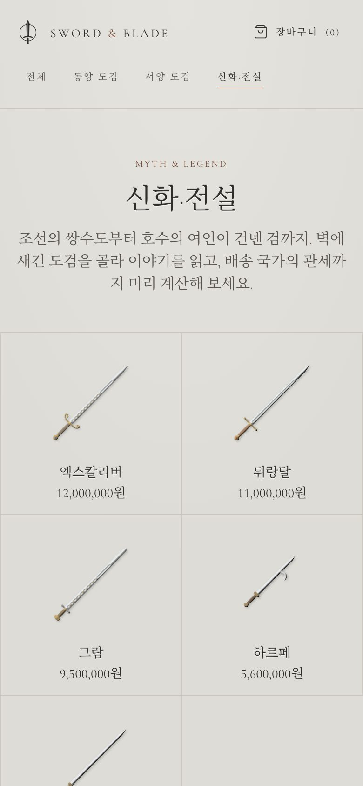
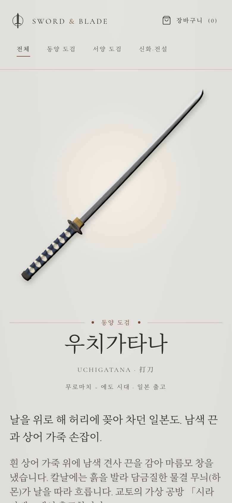

# Sword & Blade - 도검의 벽

[](https://github.com/ryushin01/swordnblade/actions/workflows/ci.yml)


동양 도검부터 신화 속 검까지, 석고 벽에 새긴 부조처럼 진열한 도검 쇼핑몰과 관리자 화면입니다. 배송 국가에 따라 관세·부가세를 미리 계산합니다.

> **프로젝트 상태:** 실제로 판매하지 않는 **포트폴리오 프로젝트**입니다. 백엔드 없이 Mock API(MSW)로 동작하며, 상품·공방·가격·주문은 모두 가상 데이터입니다. 세율과 환율은 예시 값입니다.

## 화면

모든 도검 일러스트는 이미지 파일 없이 코드(SVG)로 그렸습니다.

| 도검의 벽 | 쌍수도 상세 |
|---|---|
|  |  |

| 장바구니 관세 계산 | 주문서 오류 안내 |
|---|---|
|  |  |

| 어드민 대시보드 | 어드민 상품 수정 |
|---|---|
|  |  |

| 모바일 신화·전설 | 모바일 상세 |
|---|---|
|  |  |

## 주요 기능

**쇼핑몰** (`apps/shop`)

| 기능 | 내용 |
|---|---|
| 도검의 벽 | 동양 도검·서양 도검·신화·전설 16점. 같은 축척으로 그려 길이 차이가 보입니다. |
| 석고 부조 일러스트 | 칼날·코등이·손잡이 감기·끝장식·술을 매개변수로 그리고 SVG 조명 필터로 부조처럼 보이게 합니다. |
| 관세 계산 | 출고지별로 묶어 계산합니다. 해외 → 한국(면세 150달러, 미국발 200달러, 관세 8%, 부가세 10%)과 한국 → 해외(국가별 CIF·FOB, 부가세)를 모두 지원합니다. |
| 허가 안내 | 칼날 15cm 이상 진검은 소지허가 대상으로 표시하고, 주문할 때 허가 안내를 확인받습니다. |
| 주문 | 오류 요약과 칸별 안내, 중복 제출 방지. 금액은 Mock 서버가 다시 계산합니다. |

**어드민** (`apps/admin`, Ant Design)

| 메뉴 | 내용 |
|---|---|
| 대시보드 | 상품·재고 부족·주문·허가 확인 대기·매출 통계 |
| 상품 | 목록(정렬·필터), 등록·수정·삭제, 일러스트 실시간 미리보기 |
| 주문 | 주문 상세 펼치기, 상태 변경 |
| 관세·환율 설정 | 환율, 배송비, 국가별 관세율·부가세율·면세 한도 |

## 기술 스택


| 구분 | 사용 기술 |
|---|---|
| 구성 | pnpm 워크스페이스, Turborepo, Feature-Sliced Design v2.1 (Steiger로 검사) |
| 프레임워크 | Next.js 16 (App Router), React 19, TypeScript 7 |
| 쇼핑몰 UI | Tailwind CSS 4, shadcn/ui(Button, Sonner), lucide-react, Cormorant Garamond·Noto Serif KR |
| 어드민 UI | Ant Design 6, @ant-design/icons |
| 상태·데이터 | TanStack Query 5, Zustand 5, MSW 3 (Mock API) |
| 품질 | Vitest 5 + Testing Library, Playwright + axe(프로덕션 빌드 E2E), Storybook 10 |
| 배포 | Netlify(앱별 사이트), GitHub Actions |

## 시작하기

Node.js 22 이상(`.nvmrc`)과 pnpm 12가 필요합니다.

```bash
corepack enable pnpm
pnpm install
pnpm dev    # 쇼핑몰 http://localhost:3000 · 어드민 http://localhost:3001
```

| 명령 | 설명 |
|---|---|
| `pnpm build` | 두 앱 프로덕션 빌드 |
| `pnpm test` | 단위·컴포넌트 테스트 (도메인, Mock API, 일러스트, 두 앱) |
| `pnpm typecheck` / `pnpm lint` | 타입 검사 / FSD 규칙 검사(Steiger) |
| `pnpm --filter @snb/shop e2e` | 쇼핑몰 프로덕션 빌드 E2E (먼저 `build` 필요) |
| `pnpm --filter @snb/shop storybook` | 쇼핑몰 Storybook (`http://localhost:6006`) |

## 프로젝트 구조

```
apps/
├─ shop/       쇼핑몰 (Next.js, FSD: _app · _pages · widgets · features · entities · shared)
└─ admin/      어드민 (Next.js + Ant Design, FSD)
packages/
├─ domain/     타입, 관세 계산, 표시 형식
├─ mocks/      시드 데이터, Mock DB, MSW 핸들러
└─ sword-art/  도검 부조 SVG 렌더러, 칼날 로고
docs/          문서와 스크린샷
```

## 문서

| 문서 | 내용 |
|---|---|
| [개발 가이드](docs/development.md) | 구조, FSD 규칙, Mock API, 테스트, 접근성 점검 |
| [디자인](docs/design.md) | 참고 사이트, 석고 팔레트, 부조 일러스트 원리 |
| [관세 계산](docs/customs.md) | 계산 규칙, 국가별 예시 값, 허가 안내 |
| [CI · 배포](docs/ci-deploy.md) | GitHub Actions, Netlify |
| [버전 기록](CHANGELOG.md) | 버전별 변경 내용 |
